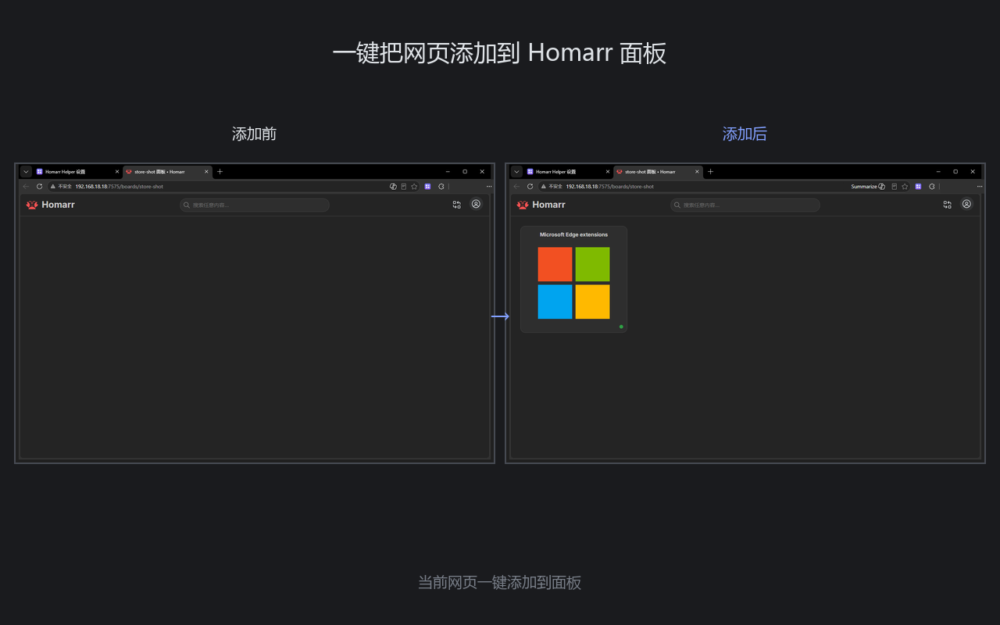
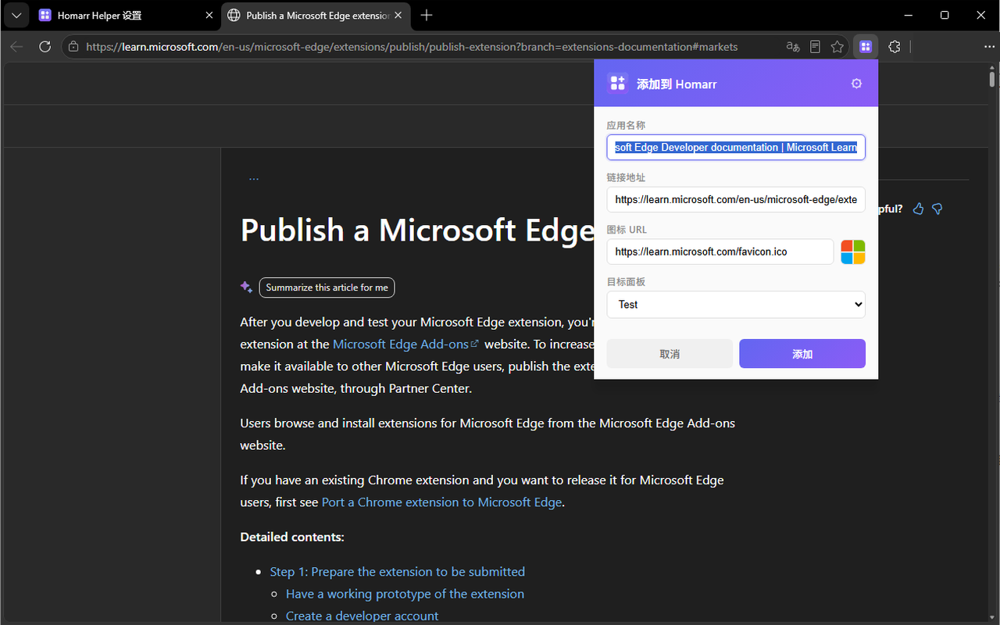
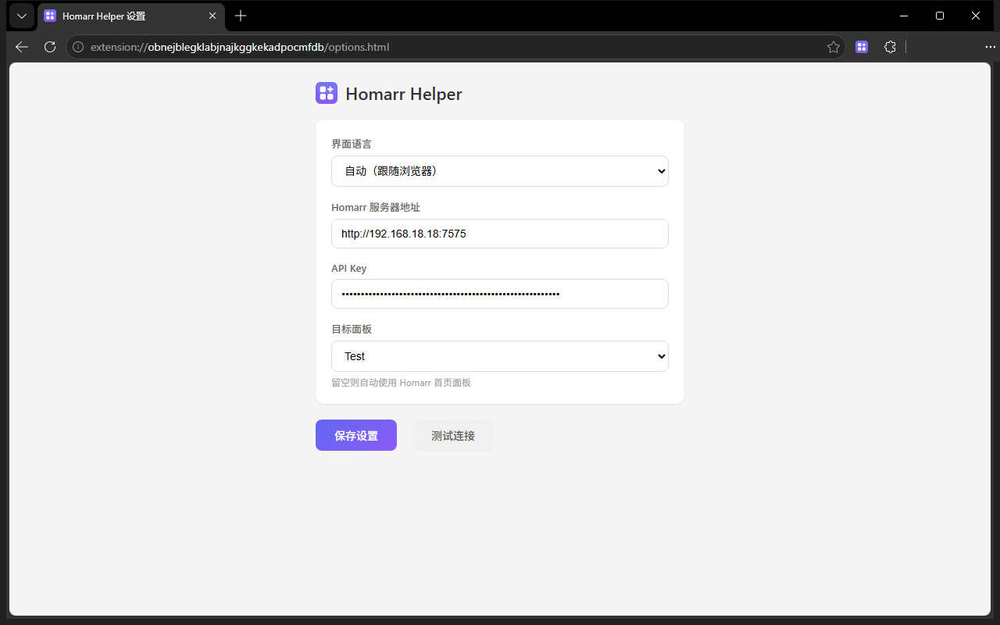
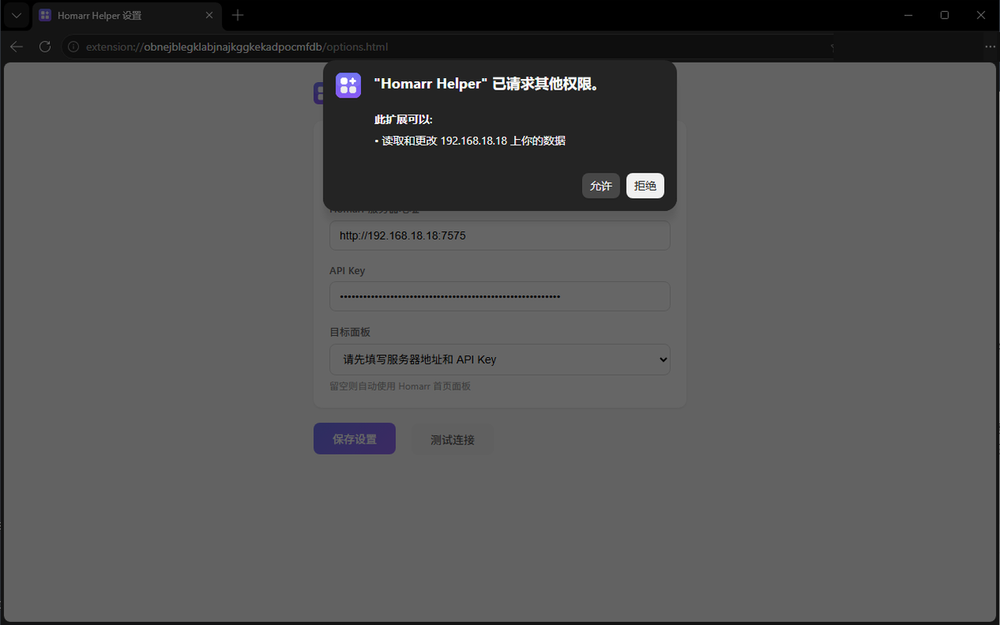
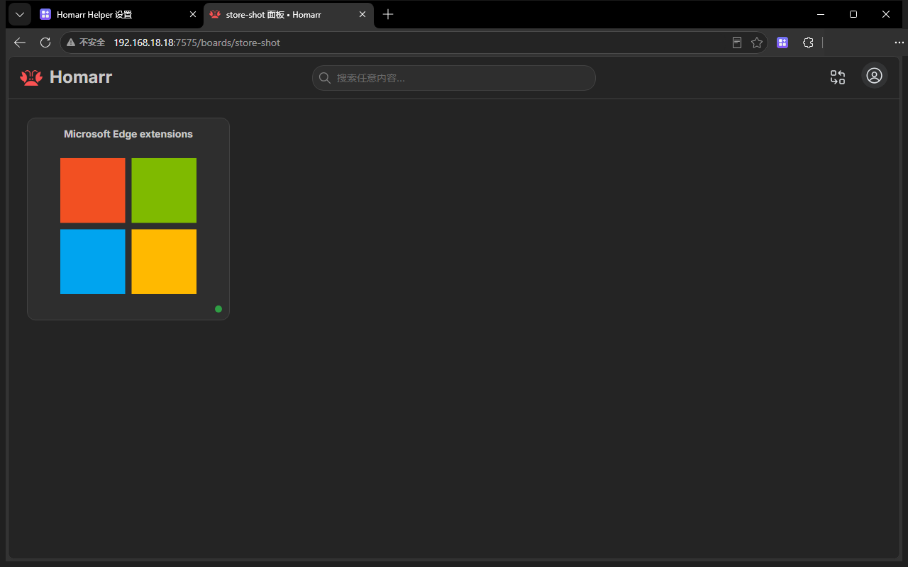

# Homarr Helper

一键将当前浏览页面添加到 [Homarr](https://github.com/homarr-labs/homarr) 导航面板的浏览器扩展。

A browser extension that adds the current page to your [Homarr](https://github.com/homarr-labs/homarr) dashboard with a single click.

> English README: [doc/README.md](doc/README.md)

## 功能

- 点击扩展图标，弹出编辑框，自动预填页面标题、网址和图标
- 所有字段均可手动修改后确认添加
- 自动记忆上次使用的面板，也可手动切换
- Edge 用户可直接从 [Edge 扩展商店](https://microsoftedge.microsoft.com/addons/detail/nbbegamjhmmkladlhnimbioejoiggohb) 一键安装；Chrome / Brave 可从 Release 加载
- 界面支持中英文双语，根据浏览器语言自动切换

## 安装

### 方式一：从 Edge 扩展商店安装（推荐）

1. 打开 [Microsoft Edge Add-ons](https://microsoftedge.microsoft.com/addons/detail/nbbegamjhmmkladlhnimbioejoiggohb)（或 [Edge 商店搜索 Homarr Helper](https://microsoftedge.microsoft.com/addons/search/Homarr%20Helper)）
2. 点击「获取」/「Add to Chrome」，然后确认「添加扩展」

安装后打开 Edge，在工具栏拼图图标里找到 Homarr Helper 并**固定到工具栏**即可使用。

### 方式二：从 Release 加载

1. 从 [Releases](../../releases) 页面下载最新 `homarr-helper-x.x.x.zip`
2. 解压到任意目录
3. 打开 `chrome://extensions/`（Edge 为 `edge://extensions/`），启用右上角「开发者模式」
4. 点击「加载已解压的扩展程序」，选择解压目录

### 方式三：从源码加载

```bash
git clone https://github.com/letmebe/homarr-helper.git
```

然后在 `chrome://extensions/` 加载项目目录。

## 配置

首次安装后会自动打开设置页面，需要填写：

- **Homarr 服务器地址** — 例如 `http://192.168.18.18:7575`
- **API Key** — 在 Homarr 管理面板 → 工具 → API 中创建

点击「测试连接」确认通过后保存即可。首次测试或保存某个地址时，浏览器会询问是否允许访问该地址——扩展只申请你填写的这一个地址的权限，可随时在浏览器扩展设置中撤销。

## 使用

1. 浏览任意网页
2. 点击浏览器工具栏上的 Homarr Helper 图标
3. 在弹出框中确认或修改应用名称、链接、图标
4. 选择目标面板，点击「添加」

## 截图

> 界面会跟随浏览器语言自动切换，以下为中文界面。

添加前后对比——当前页面一键写入面板：



点击工具栏图标，标题、网址与站点图标自动预填，选择目标面板即可添加：



首次使用时填写服务器地址与 API Key，「测试连接」通过后保存：



首次访问该地址时，浏览器会询问是否允许扩展访问——只申请你填写的这一个地址：



新标签页会跳转到已配置的 Homarr 面板：



更多截图见 [doc/store-shots/](doc/store-shots/)。

## 更新日志

版本变更记录见 [CHANGELOG.md](CHANGELOG.md)，完整历史见 [Releases](../../releases)。

## 批量导入

需要一次性迁移大批量书签？可以使用附带的命令行工具 **importToHomarr**：只要数据能整理成 Excel（至少包含 URL 列），即可自动检测可用性、匹配图标、按面板批量导入 Homarr。

详见 [tools/importToHomarr/README.md](tools/importToHomarr/README.md)。

## 开发

项目为纯 Manifest V3 扩展，无构建步骤，直接修改源文件后在扩展管理页刷新即可。

```
├── manifest.json              # 扩展清单
├── background.js              # Service Worker（API 调用）
├── popup.html / popup.js      # 弹出编辑框
├── options.html / options.js  # 设置页面
├── newtab.html / newtab.js    # 新标签页跳转
├── i18n.js / i18n-core.js     # 国际化（HTML 属性处理 / 核心取词）
├── _locales/
│   ├── zh_CN/messages.json    # 中文（简体）语言资源
│   └── en/messages.json       # 英文语言资源
├── icon48.png / icon128.png   # 图标
└── tools/
    └── importToHomarr/        # 批量导入命令行工具（独立使用，非扩展依赖）
```

## 声明 / Disclaimer

- Homarr Helper 是社区开发的第三方工具，**与 Homarr 官方（homarr-labs）无任何隶属、合作或背书关系**。
  Homarr Helper is an independent, community-made tool. It is **not affiliated with, endorsed by, or sponsored by** the Homarr project (homarr-labs).
- "Homarr" 名称仅在描述本工具所服务的目标软件时作指代使用（nominative use）；Homarr 名称与标志的权利归其各自所有者。本扩展图标为原创设计，未使用 Homarr 官方标志。
  The "Homarr" name is used solely to identify the software this extension integrates with. All rights in the Homarr name and logo belong to their respective owners. The extension icon is an original design and does not use the official Homarr logo.
- 本项目代码以 MIT 协议开源；Homarr 本身采用 Apache-2.0 协议，其商标权利不受代码协议约束。

## License

MIT — 详见 [LICENSE](LICENSE)。
