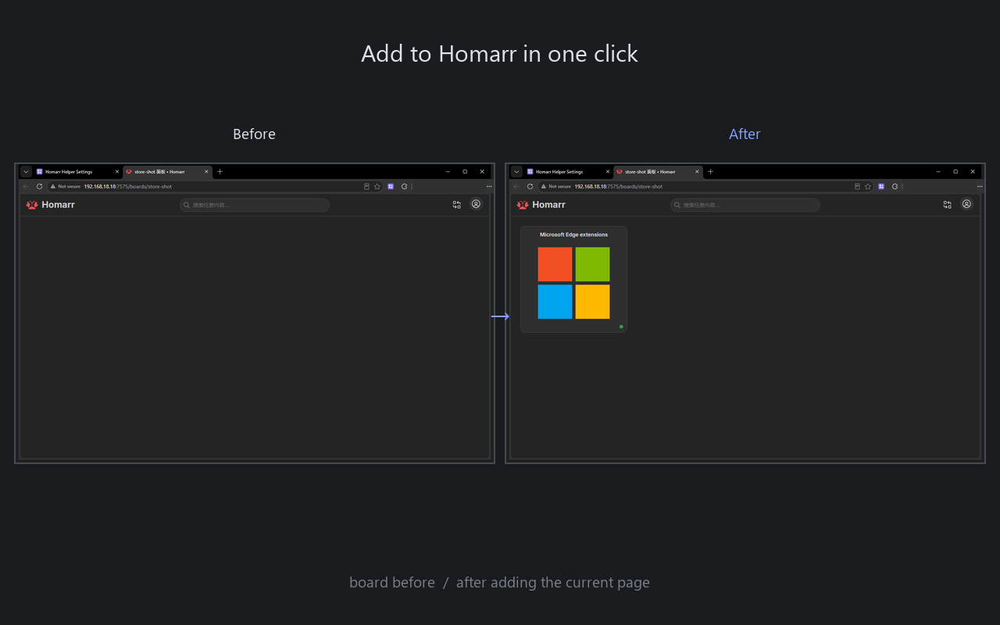
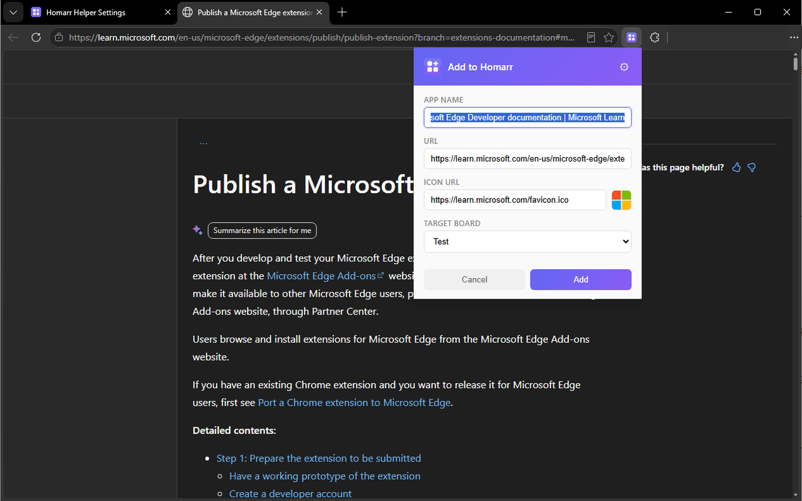
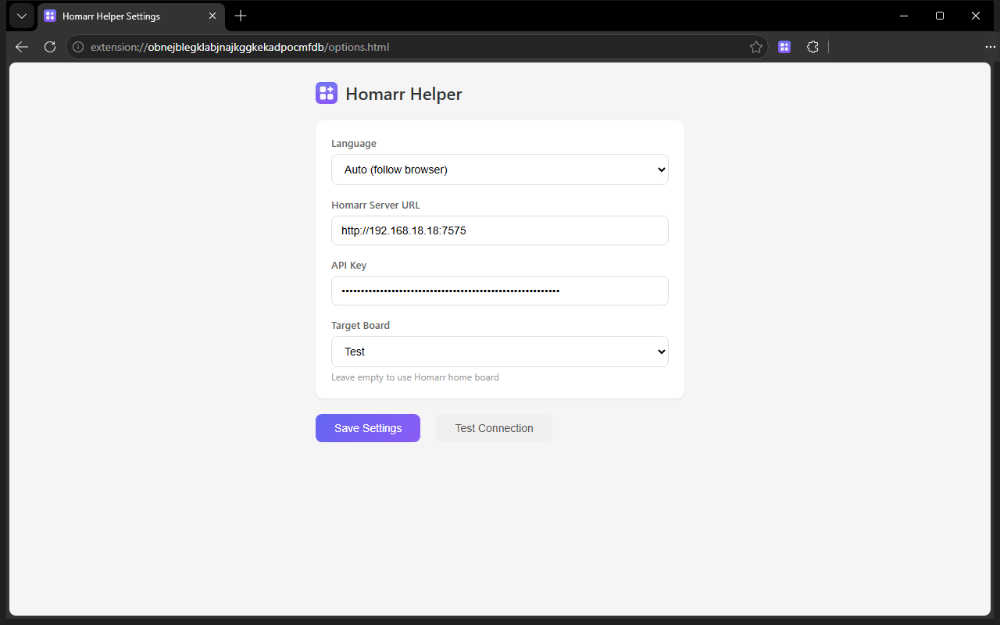
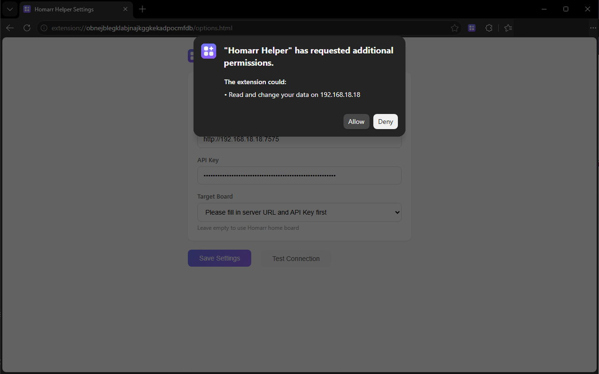
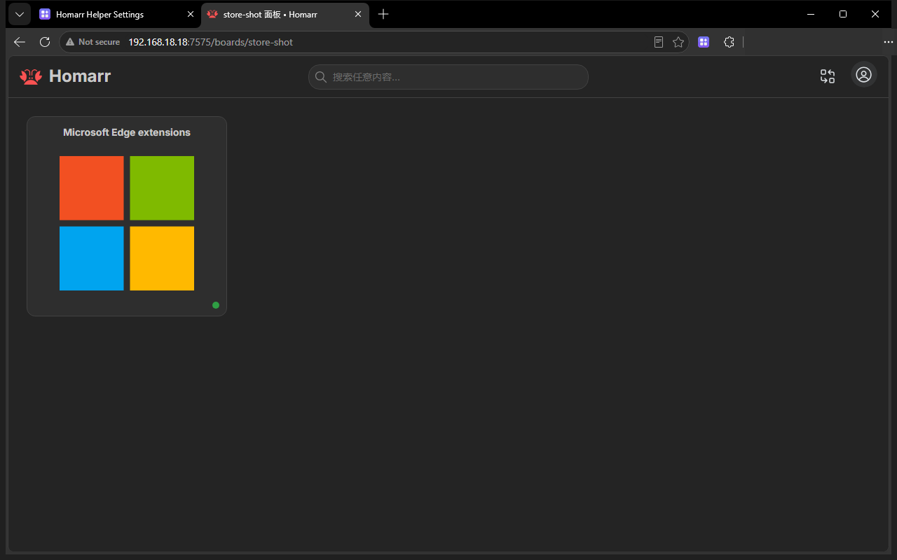

# Homarr Helper

A browser extension that adds the current page to your [Homarr](https://github.com/homarr-labs/homarr) dashboard with a single click.

一键将当前浏览页面添加到 [Homarr](https://github.com/homarr-labs/homarr) 导航面板的浏览器扩展。

> 中文版 README：[../README.md](../README.md)

## Features

- Click the extension icon to open a popup editor with the page title, URL and icon pre-filled
- Every field can be edited before you confirm the addition
- Automatically remembers the last used board, which you can also switch manually
- Edge users can install it in one click from the [Edge Add-ons store](https://microsoftedge.microsoft.com/addons/detail/nbbegamjhmmkladlhnimbioejoiggohb); Chrome / Brave users can load it from a Release
- Bilingual UI (Chinese / English), switched automatically based on your browser language

## Installation

### Option 1: Install from the Edge Add-ons store (recommended)

1. Open [Microsoft Edge Add-ons](https://microsoftedge.microsoft.com/addons/detail/nbbegamjhmmkladlhnimbioejoiggohb) (or [search for Homarr Helper](https://microsoftedge.microsoft.com/addons/search/Homarr%20Helper))
2. Click "Get" / "Add to Chrome", then confirm "Add extension"

After installation, open Edge, find Homarr Helper in the extensions (puzzle icon) menu and **pin it to the toolbar** for quick access.

### Option 2: Install from a Release

1. Download the latest `homarr-helper-x.x.x.zip` from the [Releases](https://github.com/letmebe/homarr-helper/releases) page
2. Extract it to any folder
3. Open `chrome://extensions/` (`edge://extensions/` in Edge) and enable "Developer mode" in the top-right corner
4. Click "Load unpacked" and select the extracted folder

### Option 3: Load from source

```bash
git clone https://github.com/letmebe/homarr-helper.git
```

Then load the project directory from `chrome://extensions/`.

## Configuration

The options page opens automatically after the first install. Fill in:

- **Homarr Server URL** — e.g. `http://192.168.18.18:7575`
- **API Key** — create one in Homarr Admin Panel → Tools → API

Click "Test Connection" to verify, then save. The first time you test or save an address, the browser asks whether the extension may access it — access is requested for that single address only, and you can revoke it at any time in the browser's extension settings.

## Usage

1. Browse any webpage
2. Click the Homarr Helper icon in the browser toolbar
3. Confirm or edit the app name, URL and icon in the popup
4. Select a target board and click "Add"

## Screenshots

> The UI language follows your browser. The images below show the Chinese UI.

Before and after — the current page lands on your board with one click:



Click the toolbar icon: title, URL and favicon are pre-filled, pick a board and add:



On first use, fill in the server address and API key, then save once "Test connection" passes:



The first time the extension reaches that address the browser asks for access — only for the single address you entered:



The new tab page redirects to your configured Homarr dashboard:



More screenshots are available in [doc/store-shots/](store-shots/).

## Bulk import

Need to migrate a large number of bookmarks at once? Use the bundled command-line tool **importToHomarr**: as long as your data can be turned into a spreadsheet (containing at least a URL column), it checks availability, matches icons and imports everything into Homarr board by board.

See [tools/importToHomarr/README.md](../tools/importToHomarr/README.md) for details.

## Development

This is a plain Manifest V3 extension with no build step. Edit the source files and reload the extension on the extensions management page.

```
├── manifest.json              # Extension manifest
├── background.js              # Service Worker (API calls)
├── popup.html / popup.js      # Popup editor
├── options.html / options.js  # Options page
├── newtab.html / newtab.js    # New tab redirect
├── i18n.js / i18n-core.js     # i18n (HTML attribute processing / core string lookup)
├── _locales/
│   ├── zh_CN/messages.json    # Chinese (Simplified) strings
│   └── en/messages.json       # English strings
├── icon48.png / icon128.png   # Icons
└── tools/
    └── importToHomarr/        # Bulk import CLI (standalone, not required by the extension)
```

## Disclaimer

- Homarr Helper is an independent, community-made tool. It is **not affiliated with, endorsed by, or sponsored by** the Homarr project (homarr-labs).
- The "Homarr" name is used solely to identify the software this extension integrates with. All rights in the Homarr name and logo belong to their respective owners. The extension icon is an original design and does not use the official Homarr logo.
- This project is released under the MIT license; Homarr itself is licensed under Apache-2.0, and that license does not grant any trademark rights.

## License

MIT — see [LICENSE](../LICENSE).
